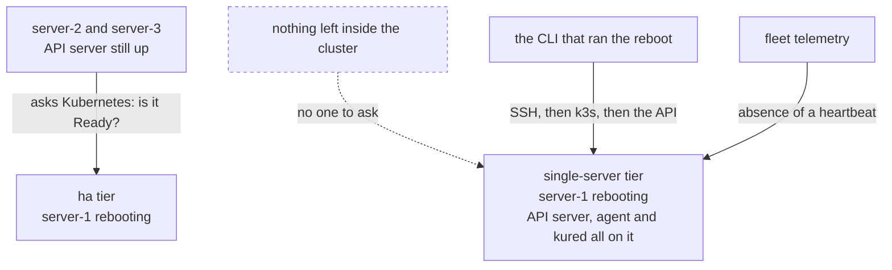

import { Callout } from 'nextra/components'

# OS patching and reboots


Kubernetes upgrades get the attention. **Unpatched hosts are what actually gets people owned.**

An unpatched kernel is not a Kubernetes problem, which is exactly why it gets left. It sits below
everything the cluster tooling looks at, it has no dashboard, and nothing fails until something
does. It is squarely inside what you are paying for.

## What gets patched

Ubuntu security updates are applied automatically on every node via `unattended-upgrades`, under
a policy the installer writes rather than one the machine image happened to have.

**Security updates only.** Feature and version updates are not applied automatically — an
unexpected package upgrade on a node running production workloads is its own kind of dread, and it
is not one we are asked to solve.

**The policy installs nothing but security updates.** k3s and its container runtime are not APT
packages, so this policy does not claim to hold them. The installer writes
`/etc/apt/apt.conf.d/52kubenest-unattended-upgrades`: it clears the inherited allowed origins,
allows only `${distro_id}:${distro_codename}-security`, and checks the effective policy with
`apt-config dump` rather than trusting the drop-in alone.

**Reboots are never APT's decision.** The drop-in sets
`Unattended-Upgrade::Automatic-Reboot "false"`; the reboot coordinator below owns that decision.
Other host services may restart when their packages update. The installer also puts
`k3s.service` and `k3s-agent.service` on `needrestart`'s ignore list so a package update does not
restart k3s outside the window.

Writing the policy rather than inheriting one is the difference between a patching behaviour we
chose, versioned and can vary per release, and whatever a given machine image does. Two customers
on two images would otherwise get two answers, and neither would be ours.

Because the operating system is locked to Ubuntu LTS, this is a single, deterministic policy
rather than a per-distribution matrix. That is one of the things locking the OS buys. The lock
itself is real and enforced: pre-flight refuses to install on anything outside the bundle's
supported OS list.

## Patches that need a reboot

Many security patches apply without interruption. Kernel patches do not — they need a reboot, and
a reboot means the node's workloads move.

So the two halves are separated:

1. **Security updates install at Ubuntu's daily unattended-upgrades time**, outside the reboot
   window if that is when they arrive.
2. **Reboots wait for permission** from the window and the coordinator, and are taken one node at
   a time.

A node that has applied a patch requiring a reboot reports as **pending reboot** and keeps running
normally until its turn.

**Need is a signal; permission is a separate decision.** Ubuntu writes
`/var/run/reboot-required` when a node needs a reboot. Fleet health reports the pending state and
when the operator first saw it. That signal does not grant permission: the window must be active
and open, and no other node may be in flight. A node carrying
`kubenest.io/auto-reboot=false` does not run kured at all; its DaemonSet's node affinity excludes
the label. That label is the whole hold. On an eligible agent, kured watches Ubuntu's ordinary
reboot marker.

## How reboots are coordinated

`kured` handles automatic agent reboots — the standard tool for the job, adopted rather than
rebuilt. An agent reboots for patches automatically, one at a time, inside the active window. It
is part of core, installed at the bundle's chart pin (`kured` 6.1.0, app 1.23.0). Servers use
the CLI's manual path below.

For each node that needs one, in turn:

| | Step |
|---|---|
| 1 | Check the reboot window is open |
| 2 | Check no other node is currently rebooting — a cluster-wide lock, one holder at a time |
| 3 | Cordon and drain within `limits.timeouts.node-drain`, respecting disruption budgets |
| 4 | Reboot |
| 5 | Wait for the node to return Ready |
| 6 | Uncordon, and only then consider the next node |

**One node at a time, always.** kured's cluster-wide lock serialises eligible agents. A stuck node
halts the sequence rather than letting a second node go down behind it. The manual CLI takes that
same lock and also checks quorum, storage and the recovery point before acting.

A node that does not return stops the current sequence and needs investigation before another
reboot is attempted. For a manual reboot the CLI waits up to
`limits.timeouts.node-reboot` (default 20m) and reports failure.

### Who is watching, and from where

Step 5 has a problem the other steps do not, and it is worth being explicit because the naive
implementation cannot work.

**On a multi-node cluster**, the API server can stay up while an agent reboots, so another node's
control plane can report when it is Ready. Preview `ha` servers still require an operator's
decision and the CLI's checks.

**On the `single-server` tier, if the node being rebooted is the control-plane node, there is no
API server to ask.** The observer went down with the observed. Anything waiting inside the cluster
for a `Ready` condition is waiting on a component that does not exist for the duration.

So on that path the wait is external, and belongs to whoever issued the reboot:

<Callout type="warning">
**Not supported by the current release.** The CLI half of this table is `kubenest node reboot`,
which is not in the command tree yet; it arrives with **Bundle 1.2, on promotion**. Fleet telemetry
observes the reboot today.

| Observer | Waits on | Reports |
|---|---|---|
| The CLI that ran `kubenest node reboot` | SSH reachable, then k3s active, then the node's own API answering | Progress, then Ready or the `node-reboot` deadline |
| Fleet telemetry | The agent's heartbeat resuming | The cluster as **unreachable** while it is down, recovered when the heartbeat returns |

</Callout>

A cluster that misses its configured number of reports goes critical as `CLUSTER_SILENT`, and every
other check it was reporting turns to `unknown` rather than staying green. The cluster showing as
unreachable during an announced reboot is correct and expected, not an incident — and it is the
only signal available once the operator's terminal is closed.



The `ha` tier can ask Kubernetes a question. The `single-server` tier can only be *waited for*,
from outside, by two observers who each see part of the picture.

<Callout type="warning">
**A `single-server` control-plane reboot that never returns is not detectable from inside the
cluster, by construction.** There is no quorum to notice, and the agent that would report is on
the machine that is gone. It surfaces as an absent heartbeat and nothing more. Whatever alerting
sits on that absence is the entire safety net for the tier.
</Callout>

### Reboot windows

```bash filename="terminal"
kubenest cluster set-window --cluster prod-1 \
  --days sun --start 06:00 --end 09:00 --timezone UTC
```

One cluster, one window, one name: `kubenest cluster set-window` writes the setting that both
bundle upgrades and reboots read. Set the first window explicitly; the standard choice is
**Sunday 06:00–09:00 UTC**, after the nightly backup, as in the example above. Outside a window,
the CLI's refusal shows the next opening in your local time and UTC. The backup schedule stays
independent, and setting a window too close to a measured backup produces a warning.

The control plane **stores** the window at a revision, then **applies** it through the operator's
k3s `HelmChartConfig` for kured. It becomes **active** only when the operator has observed kured
running the new configuration. Until a new cluster's first window is active, every node is held.
Changing a window also holds every node while the new revision is applying. If the cluster is
disconnected, the CLI reports that it may still be running its previous window; a stored revision
is not a claim that the new one is in force. A missing or invalid window holds reboots and explains
why; it never means “any time” for automatic reboots.

No node reboots automatically outside its window. A patch applied on Tuesday waits until Sunday,
reporting as pending reboot for the whole interval — visible, not forgotten. The window is permission to start:
an operation already in progress when it closes finishes safely. Outside the window,
the manual reboot command refuses and names the next opening in local time and UTC. With `--wait` it
holds nothing while waiting; when the window opens it takes the lock and re-checks the window,
quorum, storage, interlock and recovery point. `--now` bypasses only the window, never those
safety checks.

## The single-server caveat

**On a `single-server` cluster, rebooting the control-plane node is a full control-plane outage,
and it will not happen automatically.**

While that node is down: your workloads on other nodes keep running, because the kubelet does not
need the API server. But nothing schedules, nothing self-heals, no deploy succeeds, and a pod that
dies is not replaced. If the control-plane node also runs workloads, those stop until it returns.

KubeNest does not taint the control-plane node or otherwise reserve it for system components, so
application workloads can land there by default. Unless you have constrained scheduling and
verified placement, plan for some workloads to stop during this reboot. On a one-node cluster,
every workload is on that node and the reboot is a full application outage.

That is an announced, deliberate action, not something a daemon does at 3am. So the node reports
pending reboot and **waits for an explicit decision**:

<Callout type="warning">
**Not supported by the current release.** `kubenest node reboot` is not in the command tree; it
arrives with **Bundle 1.2, on promotion**, and until then no released CLI has this verb.

```bash filename="terminal"
kubenest node reboot --cluster prod-1 --node server-1 --confirm
```

</Callout>

Agent nodes on a single-server cluster reboot automatically within the window as normal. It is
the server that requires a human. Preview `ha` servers also never reboot themselves in 1.2.
Each server waits for an explicit CLI reboot decision, one server at a time. For a
normal patch reboot, wait for the window and for the node to return:

<Callout type="warning">
**Not supported by the current release.** This manual reboot command arrives with **Bundle 1.2, on promotion**.

```bash filename="terminal"
kubenest node reboot --cluster prod-1 --node server-1 --confirm --wait
```

</Callout>

<Callout type="warning">
This is a real, recurring operational task for both server tiers in 1.2. On `ha`, the CLI checks
quorum before touching a server. See [HA tiers](/ha).
</Callout>

## Seeing patch state

Every node reports through fleet telemetry. The `os_patching` health group carries the updates
timer's last attempt, last success and last failure, with the age of that evidence; whether a
reboot is pending, since when it was first seen, and for how long; whether the node is eligible
for automatic reboots or requires a manual one; and when its boot ID last changed. A missing
reporter or missing evidence reads `unknown`, never “current.” These are observations of the update
process and reboot state, not an inventory of installed patches.

<Callout type="warning">
**Not supported by the current release.** This health command arrives with **Bundle 1.2, on promotion**.

```bash filename="terminal"
kubenest health --cluster prod-1 --json
```

</Callout>

This is in core, not a profile. Patch state is one of the fleet health groups alongside backup,
nodes and the control plane.

**A pending reboot warns after seven days and goes critical after fourteen** — the same
warning-then-critical shape the bundle already uses for expiring certificates, and both numbers
live in the manifest so a release can retune them without shipping a backend. Seven days is a
missed window; fourteen is a pattern.

The report cannot determine the severity of an individual uninstalled or applied patch. If you
need to prioritise a particular advisory, check Ubuntu's advisory and the host's package state.

## Certificates

k3s leaf certificates renew when k3s restarts within 120 days of expiry. An agent that reboots
for patches gets that renewal as a side effect. Servers do not reboot automatically, so renew
their leaf certificates deliberately, one server at a time, by restarting k3s without rebooting
the host:

<Callout type="warning">
**Not supported by the current release.** This k3s-only reboot command arrives with **Bundle 1.2, on promotion**.

```bash filename="terminal"
kubenest node reboot --cluster prod-1 --node server-1 --k3s-only --confirm --wait
```

</Callout>

On a `single-server` cluster this briefly interrupts the Kubernetes API. The CLI waits from
outside for k3s and the API to return.

## What S3 measured

The 2026-09-28 S3 patch-night run used a three-node lab (one server, two agents) at bundle 1.2,
plus a separate single-server cluster. On that fixture the first agent rebooted 19 minutes after
the window opened and the second 70 minutes after. Across 2,339 watcher samples no two nodes were
cordoned or NotReady together. All 4,273 outside workload probes succeeded with two ready
replicas. The single-server manual reboot returned in 2m37s. The original bead wrote a 45-minute
two-agent limit, but kured 1.23.0 checks each node hourly and permits one reboot at a time; the
current gate allows two periods plus 15 minutes after opening. The 70-minute second reboot fits
that cadence. Fresh Ubuntu 24.04 hosts had no pending security update to exercise the real
unattended-upgrades path, and the automated server-reboot arm did not pass in that run. S3 remains
a partial hardware result until a current-candidate gate run passes every arm. These numbers
describe this fixture, not a general reboot-time guarantee.

